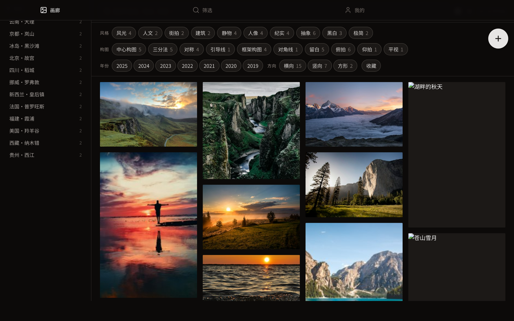

# Photo Library

Your photos stop hiding in the camera roll: filter by place, style, and composition, then send someone a link to the exact same batch you see.

[简体中文](./README.md)



## What it is

A private photography library PWA for a single owner—mobile first, enhanced on desktop. Photos and tags live on the device by default; cloud sync is an optional one-way backup and never uploads originals.

The point is to turn "scroll the album until you find it" into "query your work": place, style, composition, year, and orientation are all filters, and a filtered view is a shareable URL.

## What it does

- **Gallery**: image-first three-column browsing; places on the left, style and composition filters on top.
- **Faceted filtering**: OR within one dimension, AND across dimensions; every option shows its live result count and turns grey at zero.
- **Filters in the URL**: `q`, `loc`, `style`, `composition`, `year`, and `orient` all live in the address bar, so copying the link reproduces the same batch.
- **Local-first**: works, tags, and images live in IndexedDB; browsing and filtering work offline.
- **Optional cloud sync**: connect your own Supabase to sync the 400px thumbnail and 1600px display image only—originals are not uploaded by default. Uploads use a resumable queue, and the UI reports "local only / syncing / synced / sync failed / conflict pending".
- **Installable PWA**: add to the home screen on mobile and open it like an app.

## Run it

Requires Node.js 20+ and pnpm (the `preinstall` hook enforces pnpm).

```bash
pnpm install
pnpm dev        # local development
pnpm build      # production build
pnpm test       # unit tests (vitest)
pnpm validate   # type check + ESLint + Stylelint
```

### Connect Supabase (optional)

Set your project URL and public key in the environment (names follow `.env.example` and what `src/lib` reads), then create the tables and Storage per `docs/architecture/LOCAL_FIRST_SYNC.md`. Without it the app stays fully local.

## Data and privacy

- Originals stay on-device; the cloud only receives thumbnails and display images, and only when you enable it.
- The repository contains no real photos; sample data is synthetic.
- Clearing browser data wipes the local library. For long-term use, enable sync or export a backup first.

## Technical notes

- React + Vite + TypeScript, Tailwind CSS, React Router.
- IndexedDB (`idb`) for local storage; `vite-plugin-pwa` manages the service worker.
- Facet engine and sync rules: `docs/architecture/FACET_ENGINE.md` and `docs/architecture/LOCAL_FIRST_SYNC.md`.

## Layout

```text
src/            # pages, components, facet engine, local storage
server/         # sync server and scripts
docs/           # product spec, architecture, deployment, handoff, governance
```

See `docs/architecture/PRODUCT_AND_TECHNICAL_SPEC.md` for the spec and `AGENTS.md` for the workflow.
