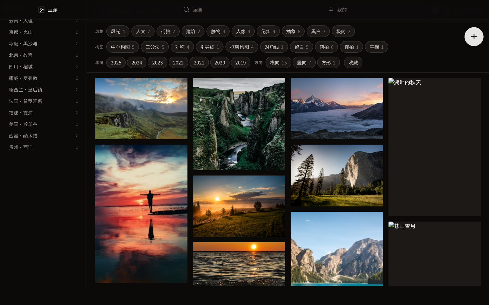

# 摄影作品库 · Photo Library

拍过的照片不再散在相册里：按地点、风格、构图筛出满意的一批，把链接甩给别人，对方看到的就是同一批结果。

[English](./README.en.md)



## 这是什么

一个给自己用的私人摄影作品库 PWA。单人使用、移动优先、桌面增强；照片与标签默认只存本机，云同步是可选的单向备份，不会把原图传上去。

它的目标是让「翻相册找图」变成「按条件找作品」：地点、风格、构图、年份、方向都能当筛选条件，筛完的地址可以直接分享。

## 能做什么

- **画廊**：以图片为主角的三栏浏览；左侧按地点分类，顶部按风格、构图筛选。
- **分面筛选**：同维度多选为 OR、跨维度为 AND；每个选项实时显示结果数量，零结果置灰。
- **筛选写进 URL**：`q`、`loc`、`style`、`composition`、`year`、`orient` 都在地址栏里，复制链接即可复现同一批结果。
- **本地优先**：作品、标签、图片存 IndexedDB；断网也能浏览和筛选。
- **可选云同步**：接自己的 Supabase，只同步 400px 缩略图与 1600px 展示图，默认不上传原图；上传走可恢复队列，界面显示「仅本机 / 正在同步 / 已同步 / 同步失败 / 冲突待处理」。
- **PWA 安装**：手机浏览器可添加到主屏幕，像 App 一样打开。

## 怎么跑起来

需要 Node.js 20+ 与 pnpm（`preinstall` 强制使用 pnpm）。

```bash
pnpm install
pnpm dev        # 本地开发
pnpm build      # 生产构建
pnpm test       # 单元测试（vitest）
pnpm validate   # 类型检查 + ESLint + Stylelint
```

### 接自己的 Supabase（可选）

在环境变量里填自己的项目地址与公开 Key（变量名以 `.env.example` 与 `src/lib` 读取为准），按 `docs/architecture/LOCAL_FIRST_SYNC.md` 的 Schema 建表与 Storage。不配置时应用保持纯本机模式。

## 数据与隐私

- 原图留在本机；云端只收到缩略图与展示图，且由你显式开启。
- 仓库里没有真实照片，示例数据为合成内容。
- 清浏览器数据会丢本地库，长期使用请开启云同步或先导出备份。

## 技术说明

- React + Vite + TypeScript，Tailwind CSS，React Router。
- IndexedDB（`idb`）本地存储，`vite-plugin-pwa` 管理 Service Worker。
- 分面引擎与同步规则见 `docs/architecture/FACET_ENGINE.md`、`docs/architecture/LOCAL_FIRST_SYNC.md`。

## 目录

```text
src/            # 页面、组件、分面引擎与本地存储
server/         # 同步相关的服务端与脚本
docs/           # 产品规范、架构、部署、交接与治理记录
```

产品与技术规范见 `docs/architecture/PRODUCT_AND_TECHNICAL_SPEC.md`，开发流程见 `AGENTS.md`。
